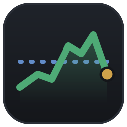

<p align="center">
  
</p>

<h1 align="center">OpenBolsa</h1>

<p align="center">Visualizador leve de ações da B3, nativo em Rust, só com dados públicos e gratuitos.</p>

## O que faz

- Baixa e guarda localmente o histórico diário oficial da B3 (COTAHIST, desde 1986).
- Mostra o preço do dia contra a média dos últimos 2 anos e destaca quem cruzou abaixo dela.
- Acompanha a cotação ao vivo durante o pregão.
- Gráfico por ativo, em linha ou candle, de 1 dia (minuto a minuto) até o histórico completo.
- Favoritos, filtros por liquidez e ordenação por qualquer coluna.

Os preços do histórico não são ajustados por proventos, desdobramentos ou grupamentos.

## Instalação

Requer Rust (edição 2024).

```sh
cargo install --path .
```

No Linux, para aparecer no menu de aplicativos:

```sh
install -Dm644 assets/openbolsa.desktop ~/.local/share/applications/openbolsa.desktop
install -Dm644 assets/openbolsa.svg ~/.local/share/icons/hicolor/scalable/apps/openbolsa.svg
```

## Uso

```sh
openbolsa            # abre o app
openbolsa --sync     # sincroniza sem abrir a janela e lista quem cruzou abaixo da média
openbolsa --sync --live
```

Na primeira execução o app baixa o histórico. O banco fica em `~/.local/share/openbolsa/openbolsa.db`.

## Fontes de dados

- **COTAHIST da B3:** histórico oficial de fechamento, publicado à noite.
- **Cotação da B3** (`cotacao.b3.com.br`): preço ao vivo e minuto a minuto do pregão.
- **Mirror do histórico:** gerado diariamente pelo workflow [`dados.yml`](.github/workflows/dados.yml) e publicado na release `dados`, para a primeira carga ser rápida.

Detalhes em [SPEC.md](SPEC.md).
